# 訂閱泡泡 Subble

用泡泡管理每個月的固定支出：**訂閱服務**和**信用卡分期**放在同一個池子裡。泡泡顏色是品牌色、大小代表每月金額，一眼就知道錢花在哪裡。

資料存在**你自己的電腦**（`data/state.json`），透過 Tailscale 讓手機、平板等綁定的裝置連回來操作，不經過任何雲端服務。

<p align="center">
  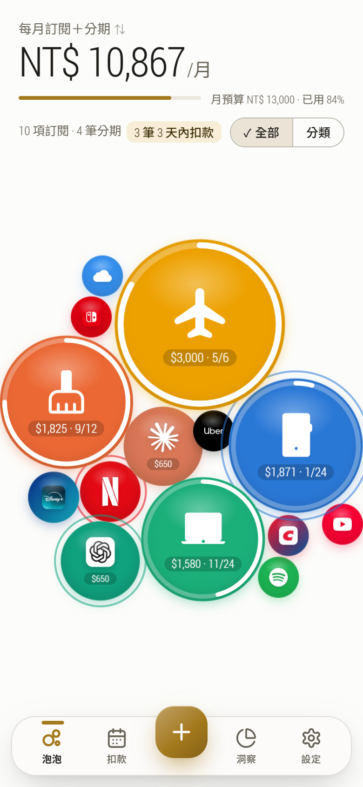
  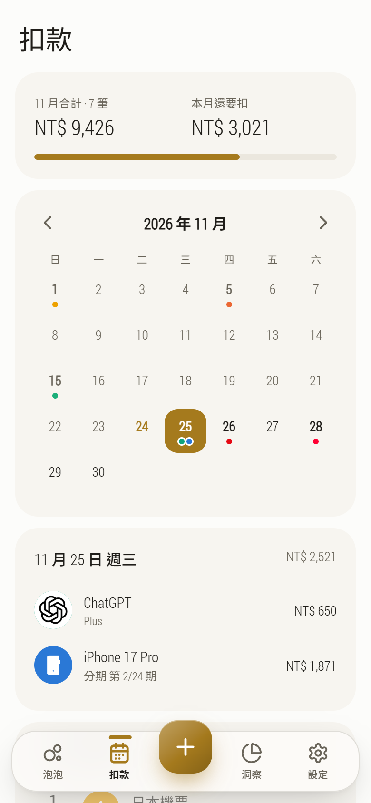
  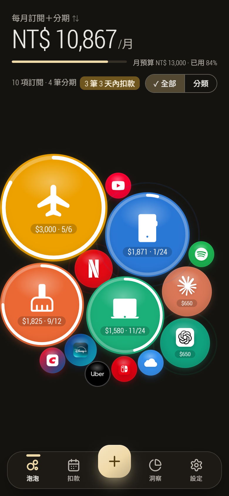
</p>

---

## 目錄
- [快速開始](#快速開始)
- [用 Tailscale 從其他裝置連線](#用-tailscale-從其他裝置連線)
- [Android App（純離線版）](#android-app純離線版)
- [操作說明](#操作說明)
  - [底部選單](#底部選單)
  - [泡泡池](#1-泡泡池)
  - [新增](#2-新增)
  - [信用卡分期](#3-信用卡分期)
  - [扣款](#4-扣款)
  - [洞察](#5-洞察)
  - [設定](#6-設定)
- [資料與備份](#資料與備份)
- [專案結構](#專案結構)
- [圖示與價格來源](#圖示與價格來源)

---

## 快速開始

需求：[Node.js](https://nodejs.org) 18 以上（不需要安裝任何 npm 套件）。

```powershell
git clone https://github.com/wyc915/Subscription.git
cd Subscription
npm start
```

開啟 <http://127.0.0.1:5178> 即可使用。第一次開啟會出現「快速多選」，勾選你有的訂閱就能開始。

| 環境變數 | 預設值 | 說明 |
|---|---|---|
| `PORT` | `5178` | 本機埠號 |
| `HOST` | `127.0.0.1` | 只接受本機連線，由 Tailscale 轉發；不建議改成 `0.0.0.0` |
| `DATA_DIR` | `./data` | 資料檔位置 |

---

## 用 Tailscale 從其他裝置連線

伺服器只監聽 `127.0.0.1`，外部無法直接連入；由 [Tailscale Serve](https://tailscale.com/kb/1312/serve) 把它對應到 tailnet 內的 HTTPS 網址，只有登入同一個 Tailscale 帳號（或被分享）的裝置能開啟。

### 一次設定好（建議）

```powershell
powershell -ExecutionPolicy Bypass -File scripts\install-autostart.ps1
```

這會：
1. 建立 Windows 排程工作「Subble Server」，登入後自動在背景啟動伺服器（輸出記錄在 `data\server.log`）
2. 執行 `tailscale serve --bg --https=5443 http://127.0.0.1:5178`
3. 印出可用的網址，例如 `https://<電腦名稱>.<tailnet>.ts.net:5443/`

在手機上打開 Tailscale App 並連線，再用瀏覽器開啟那個網址即可。Android Chrome 可從選單選「安裝應用程式」，iPhone Safari 可「加入主畫面」，就會像一般 App 一樣使用。

移除自動啟動與對應（資料不會刪除）：

```powershell
powershell -ExecutionPolicy Bypass -File scripts\uninstall-autostart.ps1
```

### 手動方式

```powershell
npm start
```

```powershell
tailscale serve --bg --https=5443 http://127.0.0.1:5178
```

查看目前的對應：`tailscale serve status`；關閉：`tailscale serve --https=5443 off`。若 5443 已被其他服務使用，換成其他埠號即可。

### 多裝置同步怎麼運作
- 所有裝置讀寫同一份 `data/state.json`。在手機上新增的訂閱，電腦上切回 App（或 20 秒內）就會出現。
- 每次寫入帶版本號；如果兩台裝置幾乎同時修改，後送出的那台會收到「其他裝置剛更新過資料，已載入最新版本」，需要的話再改一次即可。
- 暫時連不到主機時，變更會先存在該裝置，恢復連線後自動上傳。目前狀態可在「設定」最下方看到（綠點＝已連線主機）。
- 第一次連上主機時，如果主機還沒有資料，會把這台裝置瀏覽器裡原有的資料搬上去。

---

## Android App（純離線版）

`android-app/` 是用 [Capacitor](https://capacitorjs.com) 7 包裝的 Android App，和上面的電腦版**各自獨立**：

- **完全離線**：資料只存在手機（Android 原生儲存），App 沒有網路權限，不需要電腦或 Tailscale
- **扣款提醒**：扣款日前 N 天早上 9 點跳系統通知，App 關閉時也會提醒（分期會標示第幾期）
- **備份**：「設定 → 匯出備份」會產生 JSON 檔並開啟分享面板，可存到雲端硬碟或寄給自己；「匯入備份」從檔案還原。換手機、重灌或移除 App 前請先匯出
- 介面與功能和電腦版相同（網頁檔在建置時從專案根目錄複製進 App）

### 建置 release APK

需求：Node.js 20 以上、Android Studio（使用其內建 JDK 與 Android SDK）。

1. 安裝套件

   ```powershell
   cd android-app
   npm install
   ```

2. 第一次建置前，建立 release 簽章金鑰與 `android-app/keystore.properties`（兩者都不會提交到 Git，**請自行備份**；弄丟金鑰的話，新版無法覆蓋安裝）

   ```powershell
   & 'C:\Program Files\Android\Android Studio\jbr\bin\keytool.exe' -genkeypair -keystore keystore\subble-release.jks -alias subble -keyalg RSA -keysize 4096 -validity 10000
   ```

   ```properties
   # android-app/keystore.properties
   storeFile=../../keystore/subble-release.jks
   storePassword=你設定的密碼
   keyAlias=subble
   keyPassword=你設定的密碼
   ```

3. 建立 `android-app/android/local.properties`，指向 Android SDK

   ```properties
   sdk.dir=C:/Users/<使用者>/AppData/Local/Android/Sdk
   ```

4. 建置（輸出在 `android-app/android/app/build/outputs/apk/release/app-release.apk`）

   ```powershell
   $env:JAVA_HOME = 'C:\Program Files\Android\Android Studio\jbr'
   npm run build:release
   ```

修改網頁程式後重新執行第 4 步即可；要發新版時記得在 `android-app/android/app/build.gradle` 調高 `versionCode`／`versionName`，才能直接覆蓋安裝並保留資料。

---

## 操作說明

### 底部選單

浮在畫面下方的膠囊選單有 5 個位置：**泡泡 ・ 扣款 ・ ＋ ・ 洞察 ・ 設定**。

- 選中的分頁會變成品牌色，上方的小橫條會滑到該分頁。
- 中央凸起的 **＋** 在每一頁都按得到，顏色跟著品牌色主題變化。
- Android App 上點選會有輕微震動；返回鍵依序「關閉面板 → 回上一頁 → 回泡泡頁 → 退到背景」。

### 1. 泡泡池

<p>
  
  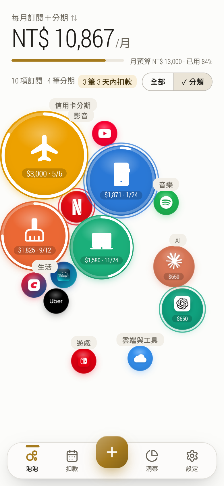
  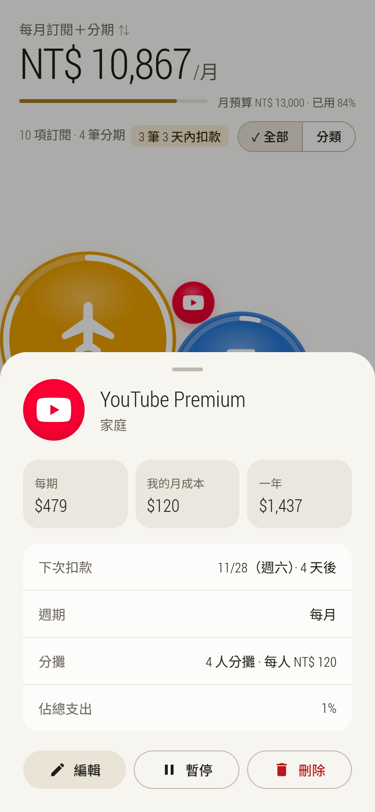
</p>

- **每顆泡泡是一項固定支出**。訂閱顯示品牌 LOGO；分期顯示品項圖示，外圈是繳款進度環。
- **大小**＝每月實際負擔（分攤後、年費換算成月）；**顏色**＝品牌色。
- **點最上方的總金額**：切換「每月」與「未來一年」（分期只算到最後一期）。
- **全部／分類**：分類模式會把泡泡依影音、音樂、AI、信用卡分期…聚成群。
- **點泡泡**：開啟詳情，可編輯、暫停、刪除。
- **拖曳泡泡**：可以甩動；拖到選單上方出現的垃圾桶就會刪除（下方提示列可「復原」）。
- **外圈脈動**：代表幾天內要扣款（天數在設定裡調整）；虛線外框代表免費試用中。
- 預算進度條會顯示本月已用幾 %，超出時變紅色。

### 2. 新增

<p>
  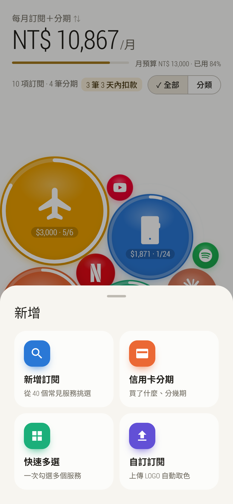
  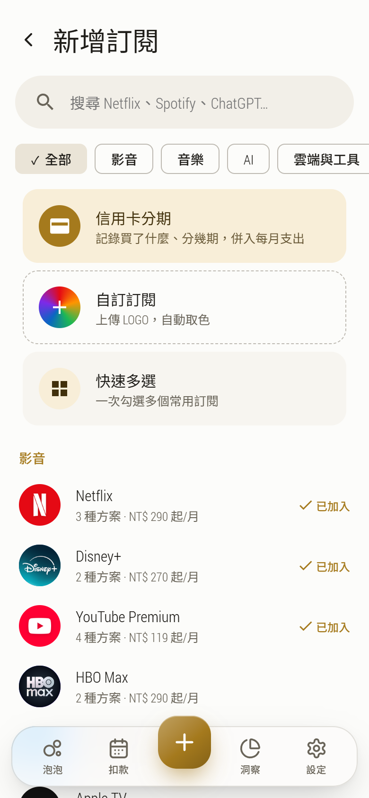
  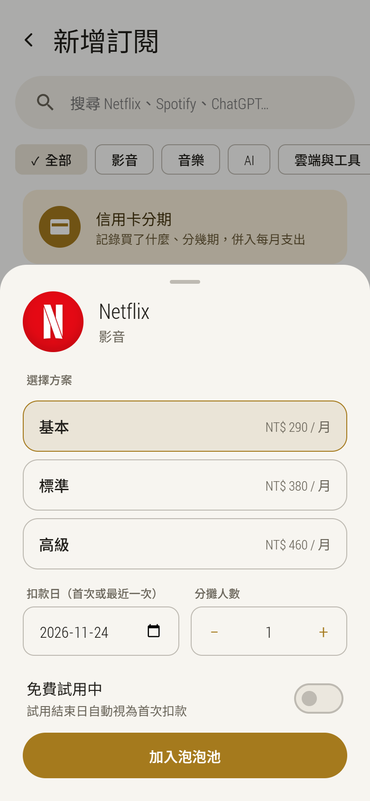
  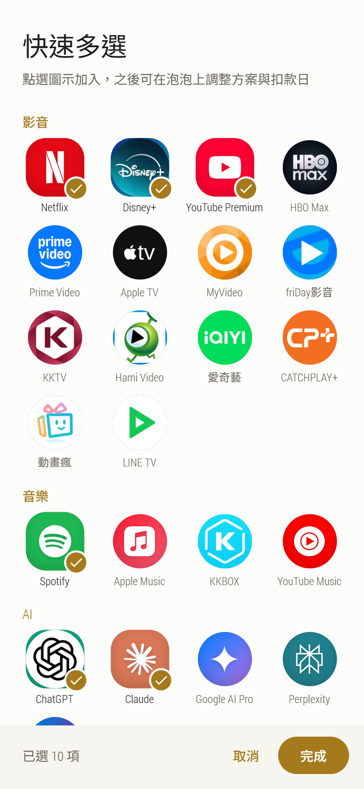
</p>

點底部中央的 **＋**，從下方選擇：

| 選項 | 說明 |
|---|---|
| **新增訂閱** | 內建 40 個台灣常見服務（影音、音樂、AI、雲端與工具、遊戲、生活），可搜尋或用分類篩選。點服務 → 選方案 → 設定扣款日、**分攤人數**（家庭方案和朋友分攤，泡泡只算你那一份）、是否**免費試用** → 加入泡泡池。左上角返回鍵回到原本的分頁 |
| **信用卡分期** | 見下一節 |
| **快速多選** | 一次勾選多個服務，之後再點泡泡調整方案與扣款日 |
| **自訂訂閱** | 清單裡沒有的（健身房、報紙…），上傳 LOGO 會自動萃取品牌色並顯示在泡泡上；可選 TWD／USD 與每週／每月／每年 |

美元計價的方案（ChatGPT、Claude…）會依設定的匯率換算台幣。

### 3. 信用卡分期

<p>
  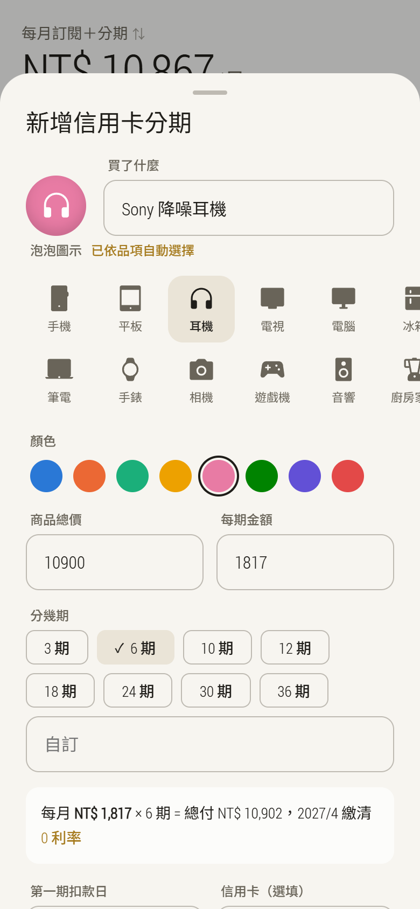
  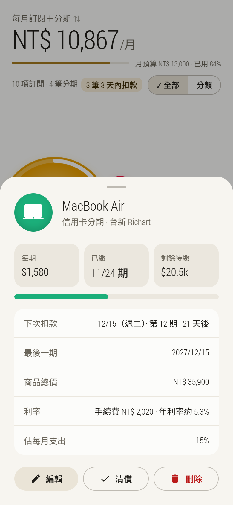
</p>

點 **＋ → 信用卡分期**：

| 欄位 | 說明 |
|---|---|
| 買了什麼 | 輸入品項時會自動挑選圖示（iPhone → 手機、Dyson → 吸塵器、機票 → 飛機…），也可手動換 |
| 泡泡圖示 | 35 個 Material Symbols 圖示 |
| 顏色 | 8 個色盲友善配色 |
| 商品總價／每期金額 | 填總價會自動算每期；若每期金額比「總價 ÷ 期數」高，會算出**手續費與實質年利率** |
| 分幾期 | 3／6／10／12／18／24／30／36 期，或自訂 |
| 第一期扣款日 | 已經在繳的分期填第一期日期，會自動算出已繳期數 |
| 信用卡 | 選填，用來統計各卡額度占用 |

- 分期泡泡顯示「每期金額 · 已繳/總期數」，外圈進度環隨繳款前進。
- 詳情頁可看下次扣款是第幾期、最後一期日期、利率；**清償**可標記提前清償（可復原）。
- 繳完最後一期，泡泡會自動離開泡泡池，並列在洞察的「已繳清」。

### 4. 扣款

<p></p>

- 上方：本月扣款合計與筆數、**本月還要扣多少**，進度條顯示已扣比例。
- **月曆**：有扣款的日子以品牌色小圓點標示，可切換上下月，「今天」一鍵回到本月。
- 點某一天：列出當天扣款項目與合計，分期會標示第幾期；點項目可開啟詳情。
- 最下方是整個月的扣款明細，已過的日子會淡化。

### 5. 洞察

<p>
  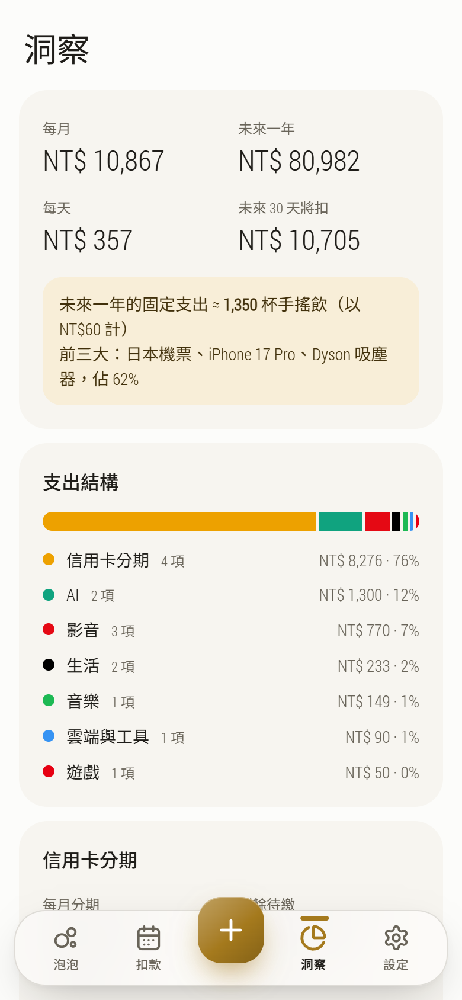
  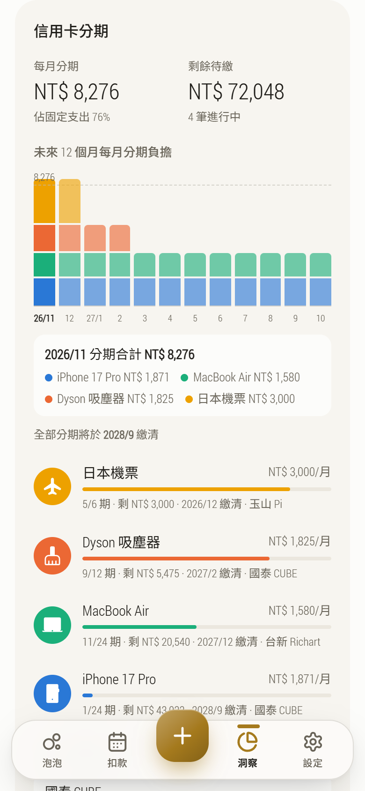
  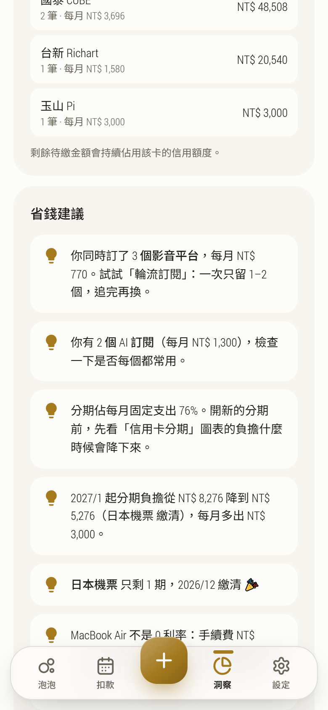
</p>

- **總覽**：每月、未來一年、每天、未來 30 天將扣款金額，並換算成手搖飲杯數。
- **支出結構**：各分類（含信用卡分期）占比。
- **信用卡分期**
  - 每月分期金額、占固定支出比例、剩餘待繳總額
  - **未來 12 個月每月分期負擔**：依品項堆疊的長條圖，點選（電腦上滑過）某個月可看明細，一眼看出負擔何時下降
  - 各品項進度條、剩餘金額、繳清月份
  - **各卡額度占用**：每張卡尚未繳完的分期總額
- **省錢建議**：影音平台太多、音樂服務重疊、家庭方案沒分攤、試用即將到期、年費即將續約、分期占比過高、哪個月起負擔下降、分期快繳完、非 0 利率分期提醒等。

### 6. 設定

<p>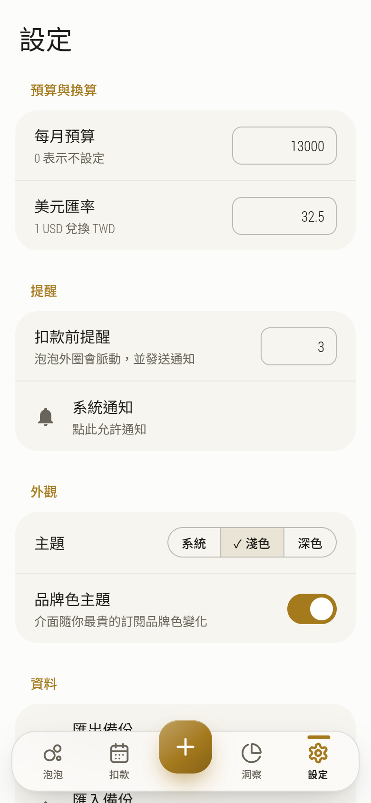</p>

- **每月預算**、**美元匯率**
- **扣款前提醒天數**；**系統通知**：網頁版需透過 HTTPS 開啟（例如 Tailscale 網址），會在開啟時通知即將扣款的項目；Android App 會在扣款日前早上 9 點通知，App 關閉時也會
- **主題**：系統／淺色／深色；**品牌色主題**：介面主色跟著你最貴的那項支出變化
- **匯出／匯入備份**（JSON）、**快速多選**、**清除所有資料**
- 最下方顯示資料狀態（電腦版：同步狀態；Android：離線版）

---

## 資料與備份

- 資料檔：`data/state.json`（已列在 `.gitignore`，不會被提交到 Git）
- 自動備份：`data/backups/state-YYYYMMDDHH.json`，每小時最多一份，保留最近 60 份
- 還原：停止伺服器 → 把想要的備份複製成 `data/state.json` → 重新啟動；或在 App「設定 → 匯入備份」
- 換電腦：複製整個 `data/` 資料夾即可

## 專案結構

```
server.js                 本機伺服器（靜態檔 + /api/state，無相依套件）
index.html                App 外殼
css/app.css               Material 3 樣式（淺色／深色、品牌色動態主題）
js/data.js                服務目錄：品牌色、方案、台幣參考價
js/icons.js               分期用 Material Symbols 圖示與品項關鍵字
js/app.js                 介面、泡泡物理引擎、分期計算、洞察、同步
sw.js / manifest          PWA（可安裝、離線快取）
icons/                    App 圖示與 40 個品牌 LOGO（512px PNG）
scripts/                  啟動、開機自動啟動、移除腳本
docs/screenshots/         README 截圖
android-app/              Android 純離線版（Capacitor 7）
  capacitor.config.json   App 名稱、ID、通知圖示設定
  scripts/prepare-web.mjs 把網頁檔複製到 www/ 供打包
  android/                Android 專案（圖示、啟動畫面、簽章設定）
```

## 圖示與價格來源

- 品牌 LOGO（`icons/brands/`，512×512 PNG）
  - 白色單色向量轉出：[Simple Icons](https://simpleicons.org)（CC0），Copilot 取自 Wikimedia Commons（公有領域）
  - 官方全彩 App 圖示：取自各品牌官網或 Google Play 商店頁
  - 各 LOGO 為其公司商標，本專案僅用於辨識服務
- 分期圖示：[Material Symbols](https://fonts.google.com/icons)（Apache License 2.0）
- 底部選單線條圖示：部分路徑改寫自 [Lucide](https://lucide.dev)（ISC License）
- 價格為 2026/11 台灣地區參考牌價，部分未經官方確認；各平台會調價，加入後可自行修改。批次更新請改 `js/data.js`。
